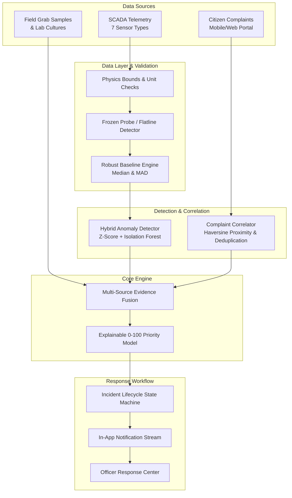

# 🌊 Water Watch AI — Anomaly Detection & Incident Response Platform

> **Problem Statement:**  
> *"Leaking pipes and dirty tanks waste water and make people sick. Build a tool that spots unusual patterns in sample sensor or complaint data and alerts the right officer."*

**Water Watch AI** is an explainable water anomaly detection, multi-source evidence fusion, and rapid incident response platform. It analyzes real-time pipe telemetry, water-quality screening data, and citizen complaints to identify suspicious patterns, distinguish hardware faults from true infrastructure bursts, calculate an explainable 0–100 operational priority score, and track officer response from detection to certified closure.

---

## 🚀 Key Differentiators & Core Innovations

1. **Multi-Source Evidence Fusion:**  
   Unlike ordinary complaint portals, Water Watch triangulates three independent data streams:
   - **Telemetry:** Pressure, Flow Rate, Tank Level, Turbidity, pH, Conductivity, Temperature.
   - **Citizen Reports:** Spatial-temporal clustering via Haversine distance, with automatic duplicate detection.
   - **Physical Grab Samples & Lab Records:** Certified laboratory verification before closing water quality events.

2. **Instrumentation Fault vs. Burst Distinction:**  
   When a sensor flatlines or repeats identical values (e.g. 5 consecutive cycles), the system classifies it as a **Sensor / Telemetry Fault**, routing it to instrumentation technicians rather than triggering a false leak panic.

3. **Transparent 0–100 Operational Priority Scoring:**  
   Every incident ranking is explainable down to its mathematical components:
   $$\text{Score} = (w_{\text{sev}} \cdot S + w_{\text{anom}} \cdot A + w_{\text{corr}} \cdot C + w_{\text{age}} \cdot Age) \times (1 - \text{Penalty})$$
   - **Severity Component ($S$, 35%):** Potential consequence based on incident type.
   - **Anomaly Magnitude ($A$, 25%):** Robust Z-score deviation ($0.6745 \times \frac{x - \text{median}}{\text{MAD}}$) and Isolation Forest score.
   - **Corroborating Evidence ($C$, 25%):** Number of independent verified citizen reports.
   - **Age Component ($Age$, 15%):** Gradual escalation over 48 hours to prevent neglect.
   - **Reliability Penalty:** 30% reduction if telemetry is flagged as low-confidence or frozen.

4. **Enforced Lifecycle State Machine:**  
   Strict transitions prevent premature closure:
   $$\text{NEW} \to \text{TRIAGED} \to \text{ASSIGNED} \to \text{INVESTIGATING} \to \text{AWAITING\_SAMPLE / AWAITING\_REPAIR} \to \text{RESOLVED} \to \text{CLOSED}$$
   Incidents can be reopened only with a documented reason.

---

## 🏛️ System Architecture



---

## 🛠️ Technology Stack

- **Frontend:** React 18, Vite, TypeScript, Tailwind CSS, Recharts (Analytics), Leaflet & OpenStreetMap (Geographic Mapping), Lucide React.
- **Backend:** Python FastAPI, Pydantic v2, SQLAlchemy 2.0, Pandas, NumPy, Scikit-learn (Isolation Forest).
- **Database:** SQLite (local zero-config) + PostgreSQL / Supabase migration script with Row Level Security (RLS) in `supabase/migrations/`.
- **Environment & Package Management:** Astral `uv` for isolated Python runtime; portable Node.js v20.

---

## 🏃 Running the Application Locally

### Prerequisites
Both Python 3.11 and Node.js v20 have been configured in your workspace environment.

### 1. Launch the Backend Server (FastAPI)
```powershell
powershell -ExecutionPolicy Bypass -File .\run_backend.ps1
```
*Backend runs on `http://127.0.0.1:8000` with interactive Swagger docs at `http://127.0.0.1:8000/docs`.*

### 2. Launch the Frontend Application (Vite + React)
```powershell
powershell -ExecutionPolicy Bypass -File .\run_frontend.ps1
```
*Frontend runs on `http://localhost:5173`.*

---

## 🧪 Running Automated Tests

Run the backend Pytest suite:
```powershell
powershell -Command "cd 'backend'; & '.venv\Scripts\python.exe' -m pytest"
```
*Result: 19 automated tests passing (covering data validation, frozen sensor detection, Isolation Forest detection, evidence fusion, priority scoring, state machine transitions, and API routes).*

---

## 🎬 3-Minute Hackathon Presentation Walkthrough

Follow this sequence to present the project:

1. **Open Landing Page (`http://localhost:5173`):**  
   Highlight the core problem statement, the 3 monitored data sources, and the 4-phase fusion pipeline.
2. **Navigate to Command Center (`/dashboard`):**  
   Show real-time KPIs, the 7-day correlation trend chart, the Leaflet geographic map with zone clusters, and the ranked alerts queue.
3. **Trigger Scenario A (Main Pipe Leak):**  
   Click **"Scenario A: Pipe Leak"** on the top Demo Banner. Show how the North Metro pressure drop (18.5 psi) and flow surge (76 m3/h) fuse with citizen reports to generate a Critical (85+/100) alert.
4. **Inspect Decision Explainability (`/anomaly_analysis`):**  
   Open the incident in the **AI Anomaly Engine** to show the mathematical weights, observed vs. expected readings, and recommended field actions.
5. **Simulate Officer Response (`/officer_center`):**  
   Assign the incident to an engineer, transition to `INVESTIGATING`, log a maintenance action ("Replaced pipe gasket"), and transition to `RESOLVED`.
6. **Trigger Scenario B (Sensor Flatline Fault):**  
   Click **"Scenario B: Sensor Fault"**. Show how a frozen conductivity probe is correctly classified as an instrumentation issue rather than a false chemical emergency.
7. **Citizen Reporting (`/complaints`):**  
   Demonstrate the citizen reporting form with category validation and anonymous submission.
8. **Admin & Standards Configuration (`/admin`):**  
   Display the municipal threshold limits, audit log trail, and downloadable CSV datasets.

---

## ⚠️ Important Public Health Limitations & Disclaimers

> **SAFETY NOTICE:**  
> Water Watch AI is a hackathon prototype designed for operational intelligence and anomaly triage. It does **NOT** certify drinking water potability or confirm microbiological safety. All synthetic readings are simulated. Water quality alerts recommend physical grab sampling and certified laboratory verification before any public health declaration.
